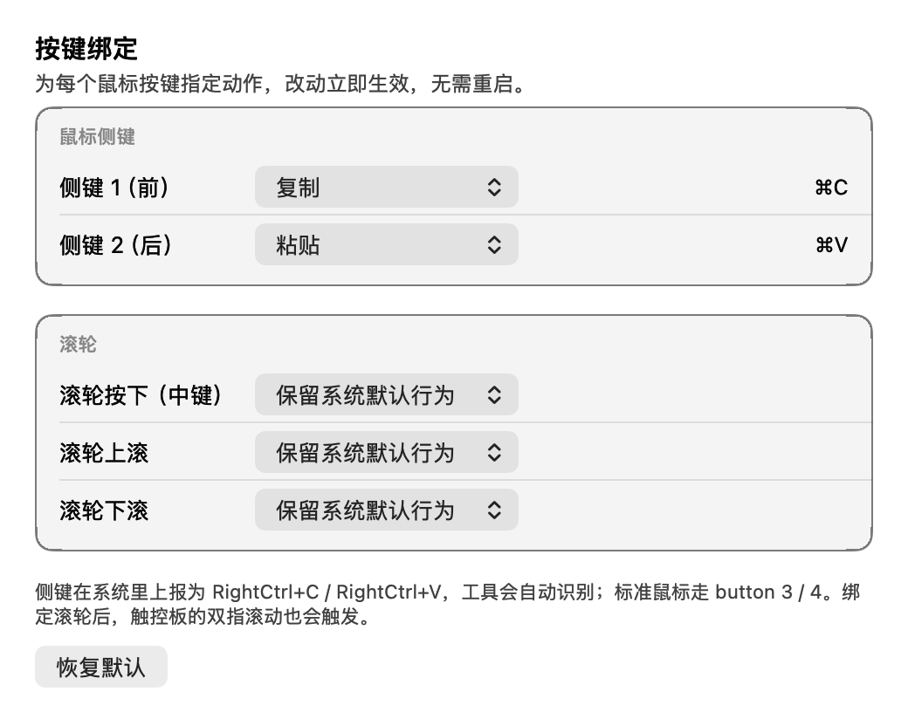
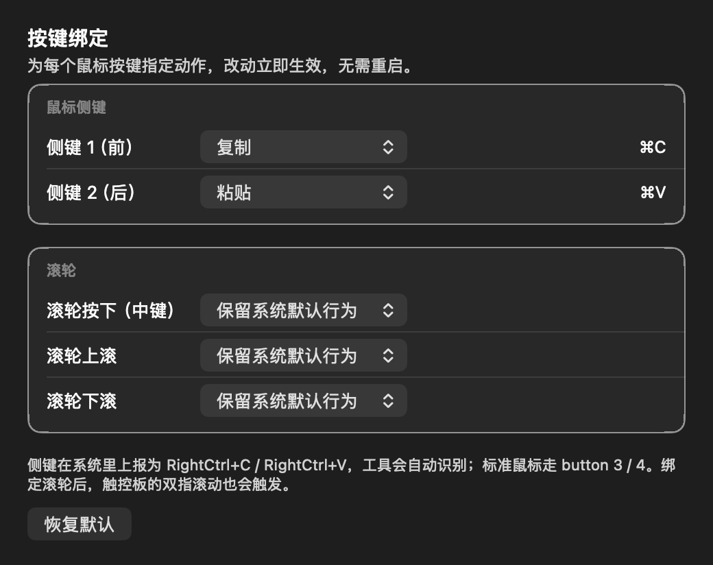

# G3M Sidekeys

极简 macOS 鼠标侧键映射工具（菜单栏 App）。为 HECATE G3M PRO 等无 macOS 官方驱动的鼠标而生，实际上对**任何 HID 鼠标**的侧键都生效。

## 功能

- 靠前侧键 → `Cmd+C` 复制，靠后侧键 → `Cmd+V` 粘贴（跟随鼠标固件原始定义）
- **每个按键的绑定都可以自己改**（v1.2.0）：侧键 1 / 侧键 2 / 滚轮按下 / 滚轮上滚 / 滚轮下滚，每个都能绑成任意组合键
- 动作类型：任意组合键（现场按键录入）、模拟鼠标左/右/中键单击、**按住修饰键（含右 Option）**、禁用此键、保留系统默认
- 菜单栏可一键交换两个侧键的绑定、暂停映射、开机自启
- 兼容标准上报 button 3/4 的鼠标侧键（拦截并吞掉原始事件，浏览器不会再触发前进/后退）
- **不记录你的任何按键**（详见「隐私」）

## v1.2.1 界面修订

这一版主要修界面上两处「看起来坏掉了」的地方：

- **菜单被一行字撑爆**。之前菜单里有一行 69 字的绑定摘要（`侧键 1（前）=⌘C · 侧键 2（后）=⌘V · 滚轮按下（中键）=保留系统默认 …`），直接把菜单撑到屏幕 97% 宽，文字还溢到菜单面板外面。现在这行摘要只列两个侧键、其余来源改过才出现，并且明细收进 **「当前绑定」子菜单**；实测菜单宽度从 **1463pt 降到 209pt**（约占屏幕 14%）。
- **设置窗口布局错位**。窗口里每一行、每条分隔线都用写死的像素宽度（130 / 260 / 170 / 600），系统字号一变就错位、内容被裁掉；窗口还写死开在 `origin (0,0)`，也就是屏幕左下角。现在改成 Auto Layout + 内容自适应尺寸，按「卡片」分组（鼠标侧键 / 滚轮），首次打开自动居中，浅色深色都跟系统走。

顺带修掉一个会显示错误字符的老问题：键名表里有一大半键码是错的（`28` 显示成 `;`、`31` 显示成 `/`、`37`/`38` 的 `L`/`J` 互换，功能键和方向键也全错），录制出来的快捷键会显示成不相干的字符。现在整张表按 Carbon 的 `kVK_*` 常量逐条核对过，并加了回归测试锁住。

设置窗口效果：

| 浅色 | 深色 |
| --- | --- |
|  |  |

## 自定义绑定（v1.2.0 新增）

菜单栏图标 → **按键绑定设置…**，弹出的窗口里一行一个按键：

| 来源 | 默认动作 | 说明 |
| --- | --- | --- |
| 侧键 1（前） | `⌘C` 复制 | G3M 上报 `RightCtrl+C`；标准鼠标为 button 3 |
| 侧键 2（后） | `⌘V` 粘贴 | G3M 上报 `RightCtrl+V`；标准鼠标为 button 4 |
| 滚轮按下（中键） | 保留系统默认 | 标准鼠标为 button 2 |
| 滚轮上滚 | 保留系统默认 | 向上滚动 |
| 滚轮下滚 | 保留系统默认 | 向下滚动 |

每一行的下拉框里有：

- **常用快捷键** —— 复制 / 粘贴 / 剪切 / 撤销 / 重做 / 全选 / 查找 / 关闭窗口 / 隐藏 / 最小化 / 切换全屏 / 切换标签页
- **自定义快捷键…** —— 弹一个录制面板，你直接在键盘上按想要的组合键（`⌘⇧A`、`⌥⌘C`……都行），按 `Esc` 取消
- **模拟鼠标左键 / 右键 / 中键单击**
- **模拟按住修饰键** —— 左/右 Option、左/右 Command、左/右 Control、Shift。按住鼠标键期间这个修饰键一直是按下的，松手就恢复
  > v1.2.2 修复：这一组分选项以前放在**子菜单**里，而 `NSPopUpButton` 根本不支持子菜单 —— 点「模拟按住修饰键」只会选中这个父项（它没有绑定动作，代码直接 return），点子项又不会更新选中状态。**结果是这 7 个选项全都点不动**。现在已摊平成一列正常的菜单项。
- **禁用此键** —— 吞掉它，不做任何事
- **保留系统默认行为** —— 完全不干预（例如侧键恢复成浏览器的前进/后退）

改动**立即生效**，不用重启 App。窗口右下角的「恢复默认」可以一键还原。

### 「按住右 Option」是怎么做到的

macOS 的修饰键标志（`CGEventFlags`）里 Option / Command / Control 各只有**一个** bit，**不记录是哪一侧的物理键**——所以「左 Option」和「右 Option」在标志层面是同一个东西。能区分左右的是**键码**：

| | 左 | 右 |
| --- | --- | --- |
| Option | 58 | **61** |
| Command | 55 | **54** |
| Control | 59 | **62** |
| Shift | 56 | 56（两侧同码，无法区分） |

本工具的做法分两层：

1. **G3M 路径**：侧键的载荷按键（固件上报的 `C` / `V`）是真实硬件事件，工具把它**改写**成目标修饰键的按下 / 抬起（键码 61 + `⌥`）。因为改的是真实事件而不是合成事件，系统会真的认为「右 Option」被按住了。
2. **后续真实按键**：按住期间，你的键盘输入会被自动补上对应的修饰键标志位，应用读到的 `modifierFlags` 就是对的。

> ⚠️ 合成一个「修饰键按下」事件是**行不通**的——macOS 会把这种自造事件直接丢弃（实测 `flagsChanged` 被丢弃、标志位被系统重算）。这也是为什么必须走「改写真实载荷按键」这条路。

### 几点说明

- 鼠标侧键上报的是 `RightCtrl`，这是鼠标伪装出来的，工具会把它剥掉；你自己按住的 `Shift` / `Option` 会保留，所以「按住 Shift 点侧键」得到的仍是 `⇧⌘C`。
- 绑定「滚轮上/下滚」之后，**触控板的双指滚动也会触发**，因为系统层面两者都是 `scrollWheel` 事件。
- 「模拟鼠标中键」这类绑定不会自己触发自己：所有注入的事件都打了 `eventSourceUserData` 标记，事件过滤器见到标记就直接放行。
- 「模拟按住修饰键」不提供「滚轮上/下滚」这一项——滚动没有按下/松开之分。
- 老的「交换复制/粘贴」开关在升级时会自动折算成「侧键 1 与 2 绑定对调」，手感不变；菜单里也保留了这个快捷项。

## 原理

G3M PRO 的侧键**不上报鼠标按键**，而是模拟键盘发送 Windows 风格的 `RightCtrl+C` / `RightCtrl+V`（HID 探针实测：usage page 0x07，usage 0xe4 + 0x06/0x19），在 macOS 上本来无效。

本工具在 HID 层创建 `CGEventTap` 事件过滤器：

1. 通过 `flagsChanged` 事件追踪 Right Control 的按下状态；
2. 拦截带 Control 标志的 C/V 按键事件，把 Control 改写为 Command（即 `Cmd+C` / `Cmd+V`）；
3. 真实键盘的 `Left Ctrl+C`（如 Terminal 中断）不受影响——只有 Right Control 按下时才转换。

对标准上报 `buttonNumber 3/4` 的鼠标，则走传统的 `otherMouseDown/Up` 拦截 + 注入快捷键路径。纯用户态，无内核扩展，不依赖厂商私有协议。

v1.2.0 起，第 2、3 步里「该变成什么」不再写死，而是查**绑定表**（`BindingTable`）：先把物理来源（侧键 1 / 侧键 2 / 滚轮按下 / 滚轮上滚 / 滚轮下滚）识别出来，再查它对应的动作。

## 安装使用（推荐）

1. 从 [Releases](../../releases) 下载 `G3MSidekeys-vX.Y.Z.zip`，解压得到 `G3MSidekeys.app`
2. 把 App 拖进「应用程序」（或任意位置），首次打开需「右键 → 打开」；如仍被拦截，执行：
   ```bash
   xattr -d com.apple.quarantine /Applications/G3MSidekeys.app
   ```
3. 按系统弹窗提示授予两项权限（也可点菜单栏图标里的对应条目直达设置页）：
   - 隐私与安全性 → 辅助功能 → G3M Sidekeys
   - 隐私与安全性 → 输入监控 → G3M Sidekeys
4. 点菜单栏图标 → 重新启动，之后侧键即可复制/粘贴

菜单栏图标里还可以：打开按键绑定设置、一键交换两个侧键的绑定、临时停用映射、设置开机自启、切换日志级别。

## 隐私

本工具**只在本机运行，不联网、不收集任何数据**。日志文件里也**不包含你按下的按键**：

- 日志默认级别是「仅错误」，只记录权限缺失、事件监听创建失败这类异常
- 只有手动切到「诊断」级别时，才会记录**侧键转换事件**（即本工具自己的动作），仍不记录普通按键
- 日志文件权限为 `0600`（仅本人可读写），目录 `0700`
- 日志有**双重上限**，不会无限膨胀：
  - **按体积**：单个文件超过 2 MB 自动轮转，最多保留 2 个历史文件
  - **按时间**：超过保留期的日志文件自动删除，**默认 7 天**
- 保留天数可在菜单里切换（1 / 3 / 7 / 30 天），改完立即执行一次清理

> v1.0.x 曾把每一次按键的 keycode 写入日志，且文件权限为 `0644`。v1.1.0 已彻底移除该行为。

## 从源码构建

只需 Xcode Command Line Tools：

```bash
./build.sh test     # 跑单元测试
./build.sh build    # 产出 G3MSidekeys.app
./build.sh all      # 测试 + 构建 + 打包 zip
./build.sh clean    # 清理

UNIVERSAL=1 ./build.sh build   # 生成 arm64 + x86_64 通用二进制
```

版本号写在 `VERSION` 文件里，构建时自动注入 `Info.plist`，不用手改 plist。

**部署目标固定为 macOS 13.0**（与 `Info.plist` 的 `LSMinimumSystemVersion` 一致），构建脚本会显式传 `-target` 并在构建后校验二进制的 `minos` 是否吻合。这一步不能省——`swiftc` 的默认部署目标会跟着本机工具链走，SDK 一升级就可能编出「要求 macOS 28」的二进制，结果在 macOS 27 上双击打不开（LaunchServices 报 `-10825`）。

## 项目结构

```
Sources/
  main.swift              程序入口
  Core/                   纯逻辑层（不依赖 UI / 文件系统，可单元测试）
    Binding.swift           绑定模型: 来源 / 动作 / 组合键 / 绑定表
    SidekeyMapper.swift     决策核心: (事件, 状态) → 动作
    AppState.swift          单一数据源 + 变更通知
    Settings.swift          UserDefaults 持久化
  Capture/                事件捕获层
    EventTapManager.swift   CGEventTap 生命周期 + 事件搬运
    EventInjector.swift     组合键 / 鼠标点击注入
  Diagnostics/
    Logger.swift            可开关 / 0600 / 自动轮转 / 异步写
  App/
    AppDelegate.swift               菜单栏界面
    BindingSettingsWindowController.swift  按键绑定设置窗口
    ShortcutRecorder.swift           快捷键录制面板
Tests/
  run_tests.swift          SidekeyMapper / BindingTable 单元测试
```

核心决策逻辑全部集中在 `SidekeyMapper.decide(...)`，是一个不碰 UI、不碰磁盘的纯函数，因此可以脱离系统事件流直接跑单元测试：

```bash
./build.sh test
```

## 设计要点

**为什么事件回调里不写日志？** `CGEventTap` 的回调有严格的响应时间预算，回调太慢系统会直接禁用该事件流（表现为侧键偶发失灵）。所以日志写入走独立串行队列异步完成，回调里只做一次入队。

**为什么 Right Control 状态要做多重自愈？** 这个状态一旦因为漏掉一次 keyup 而卡在 `true`，之后真实键盘的 `Ctrl+C` 会被全部误转成 `Cmd+C`——恰恰是这个工具要避免的场景。当前有五条纠错路径：精确的 `flagsChanged` 事件、`flagsChanged` 里已无 Control 标志、键盘事件已无 Control 标志、2 秒兜底超时、事件监听被禁用时复位。

**为什么用 `Unmanaged.passUnretained`？** 事件回调收到的事件**我们不拥有所有权**，多 retain 一次就是每事件净泄漏一个 `CGEvent`。旧版本用的是 `passRetained`，按每天数千次击键估算，一个月可累积近百 MB。

**为什么注入的事件要打 `eventSourceUserData` 标记？** 「侧键 → 模拟鼠标中键」这类绑定，如果注入的点击事件又被事件过滤器看到，就会自己触发自己、无限循环。所有注入事件都写上一个固定魔数，过滤器见到魔数就直接放行，从根上杜绝递归。

**为什么滚轮动作要节流？** 一次「滚一格」在系统里可能派发好几个 `scrollWheel` 事件（高分辨率触控板还会持续派发带动量的），不节流的话每滚一格会触发好几次动作。同方向 150ms 内只触发一次。

**为什么「按住修饰键」要改写载荷按键，而不是注入一个修饰键事件？** 实测 macOS 会**丢弃**合成的修饰键事件：`flagsChanged` 事件发出去就没了，标志位会被系统按真实硬件状态重算。唯一可行的办法是改写**真实硬件事件**——G3M 侧键的载荷按键（`C` / `V`）本来就是个真实的键盘事件，把它改写成键码 61（`kVK_RightOption`）+ `⌥`，系统就会真的认为右 Option 被按住了。

**为什么载荷的抬起必须成对改写？** 按住期间，你按下的真实按键会触发「自愈证据 C」（键盘事件不带 Control → 判定没有 Ctrl 被按住），把 `rightControlDown` 复位掉。此时若还靠 `rightControlDown` 判断，载荷的抬起就漏改了，修饰键会**卡住不放**。所以额外记了一个 `pendingModifierKeyCode`，专门用来配对改写抬起事件。

## 已知限制

- 真实键盘的 **Right Ctrl + C/V** 也会被转成 `Cmd+C/V`（无法区分鼠标模拟的 Right Ctrl 与真实键盘的 Right Ctrl）。绝大多数键盘的 Ctrl 在左侧，不受影响。
- 「滚轮上/下滚」的绑定**无法区分鼠标滚轮和触控板双指滚动**，两者在系统层面都是 `scrollWheel` 事件。
- 「按住右 Option」在 **G3M 路径**上是真正的右 Option（载荷按键被改写成键码 61，系统级生效）；**标准上报 button 3/4 的鼠标**没有载荷按键可改写，只能在应用层补标志位，此时左/右 Option 等价。
- 需要 macOS 13 或更高。

## 分发说明

当前使用本地自签名证书 `G3MSidekeys Local Codesign` 签名（身份稳定，本机权限授予一次即永久生效）。构建脚本在找不到该证书时会自动回退到 ad-hoc 签名，但 ad-hoc 签名每次重建都会变成新身份，系统权限需要重新授予。

把 `G3MSidekeys.app` 发给别人时，对方首次打开需「右键 → 打开」，或执行：

```bash
xattr -d com.apple.quarantine G3MSidekeys.app
```

如需免提示正式分发，需要 Apple Developer 账号做 Developer ID 签名 + 公证（notarization），之后也可做成 Homebrew Cask。构建脚本已默认开启 `--options runtime`（Hardened Runtime），这是公证的硬性要求。
